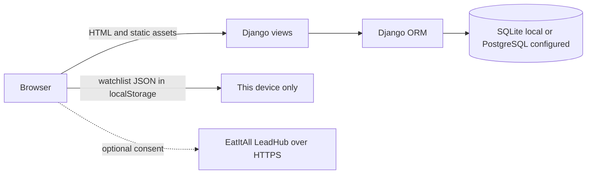
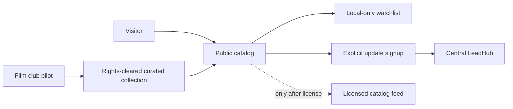

# FrameScout architecture

## Current system

FrameScout is a Django-rendered catalog backed by SQLite for local development or PostgreSQL when the documented database environment variables are present. The current watchlist lives in browser local storage. There is no user account, cloud sync, purchase, or streaming availability service.

## Boundaries and data

- Catalog fields and poster URLs are rendered from the local database. Treat each third-party field/image as licensed data, not an asset granted by the repository's source license.
- Search/filter/share URLs contain public catalog filters. Watchlist items and backup files remain in the browser/device unless the user explicitly exports them.
- The optional update form sends only a consented email address to the configured LeadHub origin; it must stay hidden without a verified HTTPS origin.
- `/healthz/` checks database connectivity. A healthy response does not prove catalog freshness, CDN availability, monitoring, backups, or a complete user journey.

## Proposed path (not implemented)

Do not add accounts, shared watchlists, recommendations, or billing until buyer interviews, data rights, privacy design, support ownership, and restore behavior justify them.

## Operational risks

- Existing public Render `/healthz/` previously returned HTTP 503; the latest local revision is not deployed.
- Production database, backups/restore drill, monitoring, rollback rehearsal, and an owner-controlled support contact are not verified.
- TMDB's free API terms are non-commercial; commercial data and imagery use requires written rights and attribution review. See [`MARKET_RESEARCH.md`](MARKET_RESEARCH.md).
